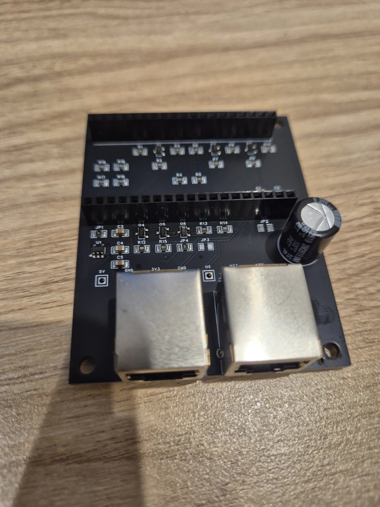
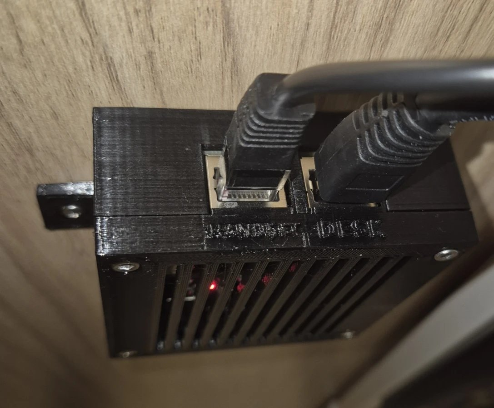

# Desk Controller V3

A small add-on board that connects a **Kaidi KDDY094** standing desk to **Home Assistant**, using an ESP32 running **ESPHome**.

  
  

It plugs in between the desk's control box and its handset. The handset keeps working exactly as before, and Home Assistant gains:

| Entity | What it does |
|---|---|
| **Desk height** | Live height while moving, updated up to 4 times a second |
| **Up / Down / Stop** buttons | Move the desk from Home Assistant |
| **Target height** | Set a height in mm and the desk drives there and stops, typically within a few millimetres |
| **Preset 1–4** buttons | Go to the desk's own memory positions (the handset's 1–4). The control box drives there and stops exactly. |
| **Handset button** | What the handset is doing right now: `up`, `down`, `preset 2`, `save preset 3 (917 mm)`, `set lower limit (754 mm)`… |
| **Desk moving** | On while the desk is moving, from Home Assistant or the handset |
| **Handset in use** | On while the handset is awake (its screen is lit) |
| **Last move result** | Why the last move ended: `stopped`, `end of travel`, `reached target (1054 mm)`, `reached preset 2 (815 mm)`, `handset took over`, `already at the top`/`bottom`, or a warning such as swapped cables |

**The handset always wins.** If you press any handset button while Home Assistant is moving the desk, the board stops its move instantly and hands control back.

**No extra power supply.** The board is powered from the desk's own handset cable.

> **Status:** V3 boards have been built and tested on a real desk (KDDY094, November 2026).

**Known behaviour.** During testing there was an unexplained edge case: on a handful of occasions the control box clicked more than the usual once as it went back to sleep. No harmful behaviour was seen beyond that, and it couldn't be reproduced. On one of those occasions the handset had stopped responding with its screen dark, and unplugging and replugging the handset cleared it. The **Handset not responding** sensor turns on if this happens.

---

## Will it work with my desk?

Only tested on a **Lazy Maisons** standing desk (2021) with these Kaidi parts, connected by a **10-wire RJ50 (10P10C)** handset cable:

| Part | Label |
|---|---|
| Control box | **KDDY094**, S440 (440 mm stroke legs), 20 V / 8 A, version `DY094-409/000838A 06-V2.5` |
| Handset | **KDH170-311**, `B000005D_V1.0` (4 memory presets plus an **S** button) |

Kaidi parts are sold under many desk brands, so check the label on your control box rather than the brand name. Different brands or batches may ship different handset firmware or settings. Other desks may work, but **check the pinout first** (see [docs/protocol.md](docs/protocol.md)). A desk with a different pinout could be damaged.

Quick check: the handset cable plug is wider than a network plug and has **10 contacts**.

## Safety and disclaimer

- **Use at your own risk.** This modifies how your desk is controlled. A moving desk can crush things, so keep the area under and around the desk clear while testing, and keep a hand near the power switch the first few times.
- **USB and the desk cable must never be connected at the same time.** To use USB: **unplug the desk cable first**, then plug in USB. When you've finished: **unplug USB first**, and only then reconnect the desk cable. Having both connected joins two power supplies together.
- The desk's own safety features (anti-collision and limits) stay in charge. The board only sends the same button commands the handset does.
- Not affiliated with Kaidi.

## What's in this package

| Folder | Contents |
|---|---|
| [hardware/](hardware/) | EasyEDA Pro project, Gerber files, BOM and pick-and-place for JLCPCB |
| [firmware/](firmware/) | ESPHome configuration (`desk.yaml`) and an example secrets file |
| [components/](components/) | The `kaidi_desk_controller` ESPHome component that `desk.yaml` uses |
| [enclosure/](enclosure/) | 3D-printable box and lid (STL), plus the Python source that generates them |
| [docs/](docs/) | Hardware notes, install guide, test checklist, desk protocol |

## Building one: overview

1. **Order the board** from JLCPCB with assembly: [docs/hardware.md](docs/hardware.md).
2. **Fit the ESP32** (a **38-pin** DevKitC-style board, 2 × 19 pins; the tested boards used a Lonely Binary ESP32 Gold Edition) into the headers. No other soldering is needed.
3. **Flash the firmware** over USB the first time. **Unplug the desk cable first**, and don't reconnect it until USB is unplugged: [docs/install.md](docs/install.md).
4. **Print the enclosure**: [docs/install.md](docs/install.md#3-enclosure).
5. **Connect it:** the desk's cable goes into **DESK**, the handset into **HANDSET**.
6. **Test it** with the checklist: [docs/testing.md](docs/testing.md).

## Credits

Protocol work built on these earlier projects:
- [xvzf/kaidi-desk-controller-protocol](https://github.com/xvzf/kaidi-desk-controller-protocol)
- [TillFleisch/ESPHomeGenericSitStandDesk](https://github.com/TillFleisch/ESPHomeGenericSitStandDesk)
- the [Home Assistant community desk thread](https://community.home-assistant.io/t/desky-standing-desk-esphome-works-with-desky-uplift-jiecang-assmann-others/383790)

## Related projects

- [clintval/esphome-kaidi-desk](https://github.com/clintval/esphome-kaidi-desk): a separate USB-powered board and ESPHome component for the same KDDY094 control box, built around an ESP32-C3.

## Licence and commercial use

**Free for non-commercial use.** You can build it for yourself, modify it and share your changes.
**Selling** boards, kits or finished controllers based on this project needs a **commercial licence**: ask in the
**"Commercial licensing"** category of this repository's **Discussions**.

- Hardware, enclosure and docs: [CC BY-NC-SA 4.0](https://creativecommons.org/licenses/by-nc-sa/4.0/)
- Firmware and scripts: [PolyForm Noncommercial 1.0.0](https://polyformproject.org/licenses/noncommercial/1.0.0/)

Details in [LICENSE.md](LICENSE.md).
