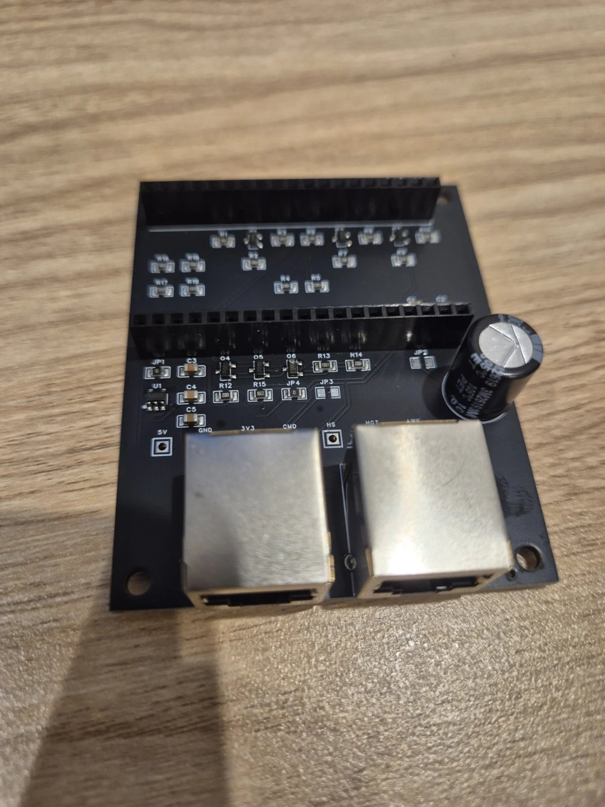

# Hardware

## The board at a glance

58 × 72 mm, 2 layers, everything assembled by JLCPCB except the ESP32, which plugs into two 19-pin headers.

| Part | What it is |
|---|---|
| **RJ1 DESK** | Cable to the desk's control box |
| **RJ2 HANDSET** | The handset plugs in here |
| **J1 / J2** | Sockets for an ESP32 DevKitC-style board. The USB end goes to the "USB ►" side; the antenna overhangs the "◄ ANTENNA" edge. |
| **U1** | 3.3 V regulator (ME6211) that powers the ESP32 from the desk's 5 V |
| **C6** | 1000 µF reserve capacitor on the 5 V line. Covers short current bursts from Wi-Fi. |
| **Q4 / Q5** | The **T7 switch**: an electronic switch in the handset's command wire. Normally closed, so the handset talks to the box. The ESP opens it only while Home Assistant is moving the desk. |
| **TP1–TP7** | Test points along the jack side: **5V, GND, 3V3, CMD, HS, HGT, AWK** |

### Jumpers

| Jumper | Fitted? | Purpose |
|---|---|---|
| **JP1** | Yes (0 Ω) | Regulator → ESP32 3V3 pin. Remove it only to power the ESP32 permanently from USB. |
| **JP2** | No | +5 V → ESP32 5V pin. Only for ESP32 boards that can't take 3.3 V on the 3V3 pin, and only with JP1 removed. |
| **JP3** | No | Bridge it to bypass the T7 switch: the handset is then always connected to the box. Home Assistant moves still work while the handset is asleep. |
| **JP4** | Yes (0 Ω) | Connects R15 (2.2 kΩ pull-up) to the desk command line. Remove it if the box misbehaves. |

### Test points

| TP | Label | Signal |
|---|---|---|
| TP1 | 5V | Desk 5 V supply (T2) |
| TP2 | GND | Ground (T3) |
| TP3 | 3V3 | Regulator output |
| TP4 | CMD | Command line, desk side of the T7 switch |
| TP5 | HS | Command line, handset side of the T7 switch |
| TP6 | HGT | Height data from the box (T8) |
| TP7 | AWK | Awake line (T10) |

Handy checks: with the desk on, 5V ≈ 5 V and 3V3 ≈ 3.3 V (measured to GND). With the handset unplugged and the switch closed, HS ≈ 3.7 V. While Home Assistant is moving the desk (switch open), HS ≈ 0 V.

## Ordering from JLCPCB

JLCPCB assembly is the tested, recommended route. Hand assembly is possible: the BOM has every part number, and the EasyEDA project and placement file show where each part goes and which way round. But it isn't documented or tested here. The parts are mostly 0805 and SOT-23 surface-mount.

Files are in [../hardware/](../hardware/):

| File | Upload as |
|---|---|
| `Desk_Controller_V3_Gerber.zip` | PCB Gerber |
| `Desk_Controller_V3_BOM.xlsx` | Assembly BOM |
| `Desk_Controller_V3_PickAndPlace.xlsx` | Assembly CPL / pick and place |

Settings used for the tested boards:

| Setting | Value |
|---|---|
| Layers / material / thickness | 2 / FR-4 / 1.6 mm |
| Surface finish | **Lead-free HASL**. Avoid OSP: it's harder to hand-solder. |
| Copper | 1 oz |
| PCB Assembly | **Economic**, top side. Assemble 2 (or as many as you need) of the 5 boards. |
| Parts selection | By customer |

When you upload the BOM, JLC warns that **TP1–TP7, JP2 and JP3 won't be assembled**. That's correct: they're meant to be empty. Click Continue.

### Parts

All from JLCPCB's library (LCSC numbers):

| Ref | Part | LCSC |
|---|---|---|
| RJ1, RJ2 | CAX RJ58-10P10C shielded RJ50 jack | C53059462 |
| J1, J2 | 1×19 female header, 2.54 mm | C319202 |
| U1 | ME6211C33M5G-N 3.3 V LDO | C82942 |
| C6 | Rubycon 16PX1000MEFC10X12.5, 1000 µF 16 V | C88777 |
| Q4, Q5 | 2N7002 | C51315010 |
| Q1, Q2, Q6 | MMBT3904 | C20526 |
| Q3 | S9012 | C8543 |
| C1, C3 / C2 / C4, C5 | 10 µF / 100 nF / 22 µF, 0805 | C15850 / C49678 / C45783 |
| R1, R6, R10, R13 | 1 kΩ 0805 | C17513 |
| R2, R7, R8, R9, R12, R14 | 10 kΩ 0805 | C17414 |
| R3 | 100 Ω 0805 | C17408 |
| R4, R16, R18 | 100 kΩ 0805 | C149504 |
| R5, R17, R19 | 220 kΩ 0805 | C17556 |
| R15 | 2.2 kΩ 0805 | C17520 |
| JP1, JP4 | 0 Ω 0805 | C17477 |

**Out of stock?** The jack (C53059462) sometimes is. JLC lets you **pre-order** it into your parts library (minimum 48 pieces) and then place the board order once it arrives. **Don't substitute a different jack** without checking its pin order: a mirrored pinout puts 5 V on the wrong wires. The jack pinout used here was verified contact by contact on a real board.

### The ESP32 board

Any ESP32 **DevKitC-style board with 38 pins: 2 rows of 19, 25.4 mm (1") apart**, labelled by GPIO number, should work.
**The common 30-pin ESP32 boards won't fit.**

**Used for the tested boards:** Lonely Binary ESP32 Gold Edition (ESP32-WROOM-32E, USB-C).

The brand shouldn't matter much. The desk's 5 V supply is weak, so the board has its own low-dropout regulator (U1)
that feeds the ESP32's **3V3 pin directly**, and the ESP32 board's own regulator isn't used. If you have trouble with a
particular ESP32 board, please report which one.

Plug it in with **pin 1 (3V3) at the antenna end**, matching the board's silkscreen. The pins used are GPIO 4, 16, 17, 18, 19 and 21, plus 3V3 and GND.

## Checking your own changes

If you modify the design, EasyEDA's design-rule check isn't enough: an earlier revision passed it with mirrored jack pins. Also confirm by hand that each jack pad carries the wire listed in [protocol.md](protocol.md), and that each test point is on the net its label names.
