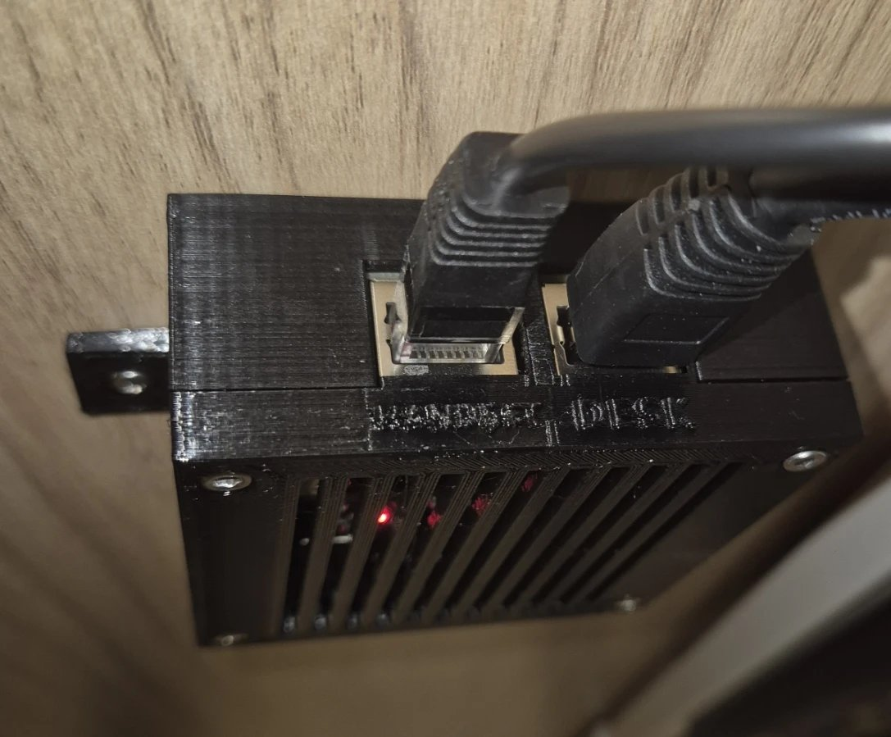

# Install guide

## 1. Firmware

You need Home Assistant with the **ESPHome Device Builder** add-on (or ESPHome on a PC).

1. In the ESPHome dashboard, open **Secrets** (top right) and add the entries from [`../firmware/secrets.example.yaml`](../firmware/secrets.example.yaml): your Wi-Fi details, an API key and a fallback hotspot password.
2. Create a new device, choose to edit it, and replace everything with the contents of [`../firmware/desk.yaml`](../firmware/desk.yaml).
3. For a second desk, uncomment its two secrets, then change the `substitutions` at the top (e.g. `name: desk2`, `friendly_name: Desk2`, `api_key: !secret desk2_api_key`) and the fallback hotspot's `password: !secret desk2_ap_password` under `wifi: ap:`. That password is read directly, not through substitutions, because a `$` in it would otherwise be taken as a variable.
4. **First install: over USB.** **USB and the desk cable must never be connected at the same time.** To use USB: **unplug the desk cable first**, then plug in USB. When you've finished: **unplug USB first**, and only then reconnect the desk cable. The ESP32 can stay in the board for this.
   1. **Unplug the desk cable** from the board's DESK jack (or from the control box).
   2. Plug the ESP32 into your computer and choose **Install → Plug into this computer**.
   3. When it's finished, **unplug USB**.
   4. **Only then** reconnect the desk cable.
5. After that, updates can go over Wi-Fi (**Install → Wirelessly**). A failed wireless update is harmless: the ESP32 keeps running its old firmware. If updates keep failing, use USB as in step 4.

Check it's running: the log shows `desk controller firmware 1.2` after each boot.

### Why the processor runs at 80 MHz

`cpu_frequency: 80MHz` **must stay**. The desk's 5 V supply is weak. At the default 240 MHz, the ESP32 reset during full-power Wi-Fi and roam scans, and wireless updates often failed partway. At 80 MHz, normal Wi-Fi settings (full power, roaming on) ran for hours without a restart, and wireless updates went through first time. The desk doesn't need more processing speed.

If your ESP32 still restarts by itself (**Uptime** drops back near 0), lower the Wi-Fi load by adding these two lines under `wifi:` (they're in the firmware as a comment):

```yaml
  output_power: 8.5dB
  post_connect_roaming: false
```

With the lower power, the signal on the tested desk was still strong (−40 to −50 dBm) a few metres from the access point.

## 2. Connecting to the desk

1. Turn the desk off at the wall.
2. Unplug the handset cable from the control box.
3. Use an RJ50 (10P10C) cable, the same type as the handset's, from the **control box** to the board's **DESK** jack.
4. Plug the **handset** into the board's **HANDSET** jack.
5. Turn the desk on. Within about a minute, the ESP32 joins Wi-Fi and the desk appears in Home Assistant (accept it under Settings → Devices & services).

Swapping the two cables by mistake should be electrically safe, because the two jacks are wired pin for pin, but the board isn't expected to work that way round and it hasn't been tested on a real desk. By design the handset should still work, while Home Assistant moves fail and **Last move result** says "check the desk and handset cables aren't swapped".

## 3. Enclosure

Files in [`../enclosure/`](../enclosure/), printed in **PETG**, no supports:

| File | Print orientation |
|---|---|
| `desk_controller_box.stl` | Base down |
| `desk_controller_lid.stl` | Flat top plate down (as exported) |

- **Board:** 4 × **M3 × 8 mm** socket head screws (M3 × 6 also works) through the board's corner holes, into the posts in the box. The 3.0 mm holes grip the screw as it goes in: turn it in firmly, but stop once it's snug. (If the screws won't go in, your printer makes holes undersize: set `PILOT_D` in `enclosure.py` to 3.1 and regenerate the box.) **Don't use screws longer than 8 mm**: the holes stop just short of the box's underside.
- **Lid:** 4 × **M3 × 14 mm** socket head screws (M3 × 12 also works; **M3 × 16 is too long**) into M3 nuts. Push a nut into the slot in each of the box's corner posts before fitting the board. The lid's screw holes are recessed, so the heads sit flush.
- The lid's 5 mm rim gives room for the ESP32. Two tongues on the lid hold the jacks down. The lid edge is labelled **DESK** and **HANDSET**, reading the right way up once the box is mounted **lid-down** under the desk.
- **Desk:** two wood screws (about 4 mm) through the side flanges.



- To change dimensions, edit and run `enclosure.py` (box) and `lid.py` (lid). They need Python with `numpy`, `trimesh`, `manifold3d` and `matplotlib`.

## 4. Using it in Home Assistant

The **Desk height** sensor reports millimetres. To see inches or cm instead, open **Desk height**, then the **settings** (gear) icon, and change **Unit of measurement**. That only changes the display; nothing needs reinstalling.

### Example: a "standing height" script

Moves the desk to a target height, then stops. Adjust the entity names to match your device. Give the target and the allowance in the unit your **Desk height** shows (mm unless you changed it).

```yaml
script:
  desk_to_standing:
    alias: Desk to standing height
    mode: single
    variables:
      target: 1054          # same unit as sensor.desk1_desk_height (mm)
      allowance: 22         # how far the desk travels after the script decides to stop
    sequence:
      - variables:
          going_up: "{{ states('sensor.desk1_desk_height') | float(0) < target }}"
      - action: button.press
        target:
          entity_id: "{{ 'button.desk1_up' if going_up else 'button.desk1_down' }}"
      # wait for the move to register, so the "not moving" check below can't end the script at once
      - wait_template: "{{ is_state('binary_sensor.desk1_desk_moving', 'on') }}"
        timeout: "00:00:03"
      - wait_template: >
          
          {{ (going_up and h >= target - allowance) or (not going_up and h <= target + allowance)
             or is_state('binary_sensor.desk1_desk_moving', 'off') }}
        timeout: "00:00:30"
      - action: button.press
        target:
          entity_id: button.desk1_stop
```

The `allowance` makes the script press Stop early, because the desk keeps travelling for a moment afterwards. On the tested desk (KDDY094) that was 17–18 mm in both directions, and `22` lands within about ±5 mm of the target. It can't be tighter than that: the height reaches Home Assistant four times a second, and the desk moves about 9 mm between updates. Tune the number for your desk: if it stops high going up (or low going down), make it bigger. If the desk is already within the allowance of the target when the script starts, it stops straight away and the desk doesn't move. The firmware also stops by itself at the desk's top and bottom limits, after 30 s, or when the handset is used.

For the four saved heights, the **Preset 1–4** buttons are simpler and exact: the control box drives to its stored height and stops by itself. Save presets on the handset as usual (**S**, then **1–4**).

### Automations that move the desk

The board never moves the desk by itself: it moves only when a button is pressed or a script runs. If you make an automation that moves it on a schedule or a trigger, add a condition so it only runs when someone is at the desk, for example a presence sensor or your PC being on:

```yaml
conditions:
  - condition: state
    entity_id: binary_sensor.your_presence_sensor
    state: "on"
```

The desk's anti-collision stays active, but don't rely on it to protect a shelf or a chair left in the way.

## Diagnostics (entity category "diagnostic")

| Entity | Use |
|---|---|
| Raw position | mm above the desk's lowest position |
| Collision sensitivity | The anti-collision level G-1 to G-4, read when the handset's sensitivity menu is used |
| Handset not responding | On when the handset is awake but has sent nothing for about 5 seconds. Unplug the handset and plug it back in. |
| Uptime | Time since the ESP32 last started. If it drops back to near 0 without an update or restart, the ESP32 restarted by itself (usually a dip in the desk's 5 V). |
| Desk status | 0 normally. 48 means the box reports **E04**: hold **Up + Down** on the handset and **don't let go** until the desk has gone to its lowest position and finished its rebound. Letting go early can damage the motor. |
| Restart | Restarts the ESP32 |
